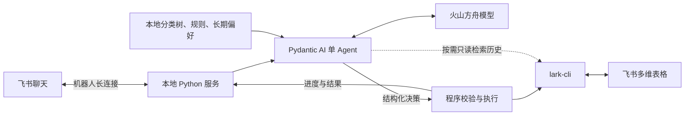

# 飞书记账智能体

向飞书机器人发一句消费描述，智能体理解日期、金额和个人分类，校验后写入飞书多维表格。让记账保留自定义账本的灵活性，同时减少逐项录入的操作。

## 为什么做这个项目

我有长期记账的习惯，但用过的记账 App 总有两点不合心意：预设分类有的太粗、有的太细，图表和复杂计算也难以按自己的想法调整。例如，饮食支出我关心的是「堂食、外卖」，而不是「早餐、午餐、晚餐」。

飞书多维表格满足了我对分类、展示和计算的自定义需求，但每次仍要打开表格，填写日期、一至三级分类、消费内容和金额。这个智能体负责把自然语言转成完整账单，账本的管理和分析继续留在多维表格中。

## 使用效果

| 发给机器人的消息 | 处理方式 |
| --- | --- |
| 今天外卖午饭 25 元 | 按个人分类规则确定完整分类，校验后记账 |
| 今天午饭 25 元 | 分类依据不足时，先追问是堂食还是外卖 |
| 不对，刚才是 28 元 | 修改当前用户、当前会话最近成功记录的账单 |
| 以后豆浆都归到饮食下的食品 | 目标分类合法且意图明确时保存长期偏好，供后续分类使用 |

飞书卡片展示实际处理进度与最终结果。当前面向个人使用，一次处理一笔文字消费，支持追问、即时纠错和明确的长期偏好更新；暂不支持图片、语音、多笔批量录入或通过机器人查询统计。

## 技术选型与架构

采用本地 Python 单进程应用，以 Pydantic AI 作为单 Agent 的运行框架，调用火山方舟模型理解消费信息。

| 选型 | 服务于什么目标 |
| --- | --- |
| Python + Pydantic AI | 记账流程较短，以单 Agent、结构化输出和受限工具调用完成理解，保持实现简单 |
| 火山方舟，接入 OpenAI 兼容接口 | 由大模型理解自然语言、消费用途和分类规则 |
| `lark-channel-sdk` + 飞书长连接 | 复用飞书聊天界面与消息通道，让本地服务直接接收消息，无需自建前端和公网回调服务 |
| 本地官方 `lark-cli` + 多维表格 | 复用已有登录态和表格读写能力，账本展示、公式与分析继续由多维表格承担 |

## 围绕记账目标做的技术设计

**1. 用显式个人知识提高分类准确性。** 核心目标是符合个人分类习惯。当前采用「完整分类知识注入 + 按需历史检索」：每轮向模型提供本地 JSON 中的分类树、个人规则和长期偏好；只有确认是实际消费且分类仍不确定时，才开放只读工具，按关键词查询表格中的历史消费。明确的长期偏好优先于旧规则，明确规则优先于历史案例；仍有歧义就追问。

这套方案暂未引入向量数据库或独立的 RAG 管线，以降低初期维护成本。分类知识可以直接查看和修改，适合当前规模的个人账本；知识规模扩大后，再评估检索方案。用户明确表达的长期偏好单独保存，不把一次纠错自动当作永久规则。

**2. LLM 自主判断，程序限制执行边界。** 模型决定是记账、纠错、追问还是更新偏好，输出结构化决策；程序校验金额、日期、完整分类路径与远端表结构，再通过固定 CLI 命令执行。模型没有写入工具或任意命令执行权限。纠错限定为当前用户、当前会话最近成功记录的账单，执行前检查是否已被外部修改，避免覆盖手工调整。

**3. 用短期上下文支持追问和纠错。** 按用户与会话隔离，只保留待补充的消费、最近账单和少量对话，默认空闲 30 分钟后过期，不维护长期聊天历史。回答追问时沿用原消息的日期基准，避免跨天补充信息改变消费日期。

**4. 让每笔写入结果可确认、可排查。** 写入前持久化消息处理状态，防止同一消息重投递时重复记账；写入超时或结果不明确时提示核对，不自动重试。卡片反馈来自实际执行事件，消息日志用于定位分类判断与写入问题。

## 进一步阅读

- [开发与运行指南](docs/开发与运行指南.md)：环境准备、配置、启动、实现入口与故障排查。
- [系统架构与工作流程](docs/系统架构与工作流程.md)：模块职责、处理流程与执行约束。
- [提示词接入说明](prompts/README.md)：模型输入上下文和结构化输出约定。
- [端到端测试方法](docs/e2e-test.md)：真实模型、飞书消息与表格写入的验收方法。
