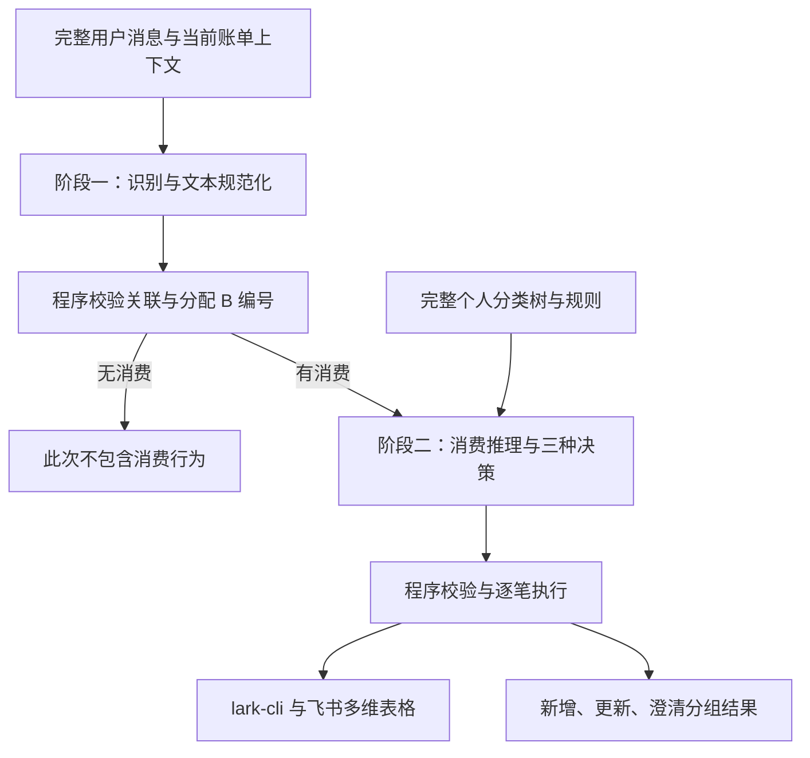

# 飞书记账智能体

向飞书机器人发送一条完整消费消息，程序通过两阶段 LLM 识别消费、推理个人分类，再校验并写入飞书多维表格。每笔消费在当前上下文窗口内都有稳定编号，可用 `B1`、`B2` 指定已有账单进行修改。

## 为什么做这个项目

我有长期记账的习惯，但预设分类和固定图表难以满足个人需求。例如，饮食支出更关心「堂食、外卖」，而不是「早餐、午餐、晚餐」。飞书多维表格提供分类、展示和计算的自定义能力；这个智能体减少打开表格逐项录入日期、分类、内容和金额的操作。

## 当前行为

<p align="left">
  
</p>

| 消息或场景 | 处理方式 |
| --- | --- |
| 今天外卖午饭 25 元 | 识别新消费、分配编号，根据个人知识分类，校验后新增 |
| 咖啡12元。午餐堂食20元。我很开心 | 按交易语义识别两笔消费，忽略闲聊；每笔独立决策 |
| B1 账单金额更新为 20 元 | 关联 B1，保留其他字段；检查远端记录后只修改金额 |
| 今天午饭 25 元，但无法判断分类 | 返回 `clarify`，说明不写入原因；不进入连续追问 |
| 明天打算买咖啡 / 闲聊 | 仅运行识别阶段，回复「此次不包含消费行为。」 |
| 一笔不合法，另一笔合法 | 分别展示执行失败与成功，合法消费继续处理 |
| 写入超时或返回结果无法确认 | 展示「待核对」，不自动重试不确定写入 |

仅支持完整文字消息。分类依据是每次第二阶段注入的完整个人分类树和规则。历史消费检索、长期分类偏好保存、连续追问和待补充账单已移除。未写入消费保留编号、原文和结果用于短期关联，不积累等待补齐的消费事实。

## 两阶段流程



LLM 负责理解和决策；程序负责编号、结构与业务校验、执行及确认。两个阶段有独立的提示词和 Pydantic Schema，模型没有业务工具。卡片处理期间仅显示实时耗时，结束后显示分组结果，失败和待核对单独展示。

正常有消费消息运行两个模型阶段；每阶段最多一次输出重试。每条消息在实际 HTTP 发送前限制最多 10 次请求，涵盖两阶段、输出校验重试、SDK 重试和重定向。开发验证优先使用离线模拟，可额外设置持久化总预算。

## 开发与运行

项目使用 Python 3.11+、Pydantic AI、火山方舟的 OpenAI 兼容接口、飞书 Channel SDK 和官方 `lark-cli`。保持一个本地 Python 应用，按用户与会话隔离上下文，默认空闲 30 分钟后过期。

```bash
.venv/bin/python -m bookkeeping_agent --check
.venv/bin/python -m pytest -q
.venv/bin/ruff check src tests
.venv/bin/ruff format --check src tests
```

- [开发与运行指南](docs/开发与运行指南.md)：安装、配置、启动与排查。
- [系统架构与工作流程](docs/系统架构与工作流程.md)：模型与程序边界、编号与执行状态。
- [两阶段提示词合同](prompts/README.md)：输入、输出、必填字段及校验约束。
- [验证方法与验收范围](docs/e2e-test.md)：离线覆盖、真实请求预算及未验证范围。
- [本次重构需求](docs/重构需求.md)：用户提供的目标与流程原文。
