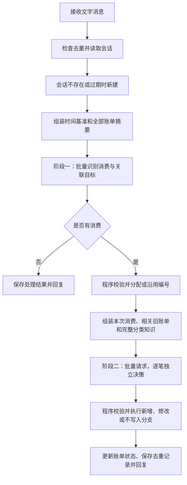

# 上下文管理策略与流程

智能体以一条完整文字消息为处理单位。程序维护短期账单状态，每条消息重新组装上下文，执行两阶段 LLM 推理。通常每条消息调用两次模型，与账单数量无关；无消费时仅调用识别阶段，输出校验失败时可能重试。

## 管理策略

- **隔离与保留**：会话按 `(user_id, chat_id)` 隔离，同一聊天串行处理。上下文保存在进程内存中，默认空闲 30 分钟后，在下一条消息进入时重置；服务重启也会清空。没有按 token 裁剪或自动摘要机制。
- **稳定编号**：新消费由程序从 `B1` 起递增编号，已有消费沿用编号。未写入消费也保留编号，窗口重置后重新编号。
- **模型可见状态**：账单摘要包含编号、当前文本、创建编号时的消息时间、状态及成功确认的完整账单快照。远端记录 ID 和执行信息由程序管理。
- **时间与固定知识**：日期以原消息发送时的配置时区为基准。系统提示词定义阶段职责，分类树与个人规则定义分类依据；两者在服务初始化时加载。

## 处理流程

| 阶段 | 输入 | 输出 |
| --- | --- | --- |
| 识别 | 完整消息、时间基准、窗口内全部账单摘要 | 新消费或已有消费修改及其原文片段 |
| 决策 | 编号后的全部消费、时间基准、仅本次关联的旧账单、完整分类知识 | 每个编号对应一个 `create`、`update` 或 `clarify` |

决策在一次请求中批量完成，每笔仅依据自身原文、相关旧账单与分类知识独立判断。两个阶段及后续消息不传递模型对话历史，日志中的 `agent.message_history` 仅用于排查。

## 状态更新边界

新增成功后保存完整确认快照；修改仅合并明确变更的字段，保留其余已确认事实。没有成功快照的已有编号不能更新，结果不确定的操作禁止再次提交。

`clarify` 表示不写入：保留编号和原因，不积累待补充事实，也不自动续填。正常处理会用本次消费或修改片段覆盖账单文本，不累积多轮原文。

操作去重记录持久化保存，窗口过期或重启后仍有效；它与详细日志均不会用于恢复会话或自动注入模型上下文。
