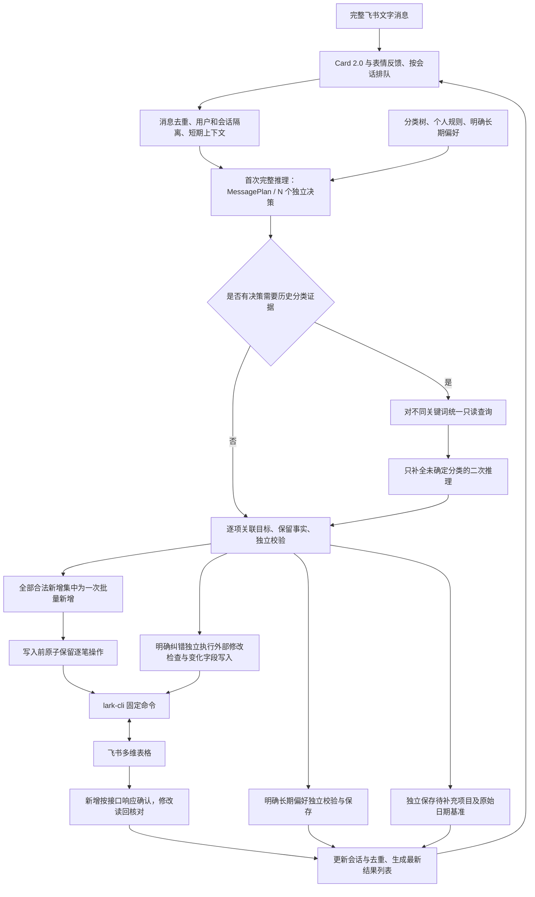

# 系统架构与工作流程

应用继续使用 Python、Pydantic AI 单 Agent、飞书 Channel SDK、`lark-cli` 和本地分类知识。模型理解完整消息并提供决策集合，程序负责目标授权、业务校验、执行确认、状态与反馈。单笔和多笔共用一条业务流程，不按标点拆分消息。

## 整体处理流程

## 模块职责

| 模块 | 职责 |
| --- | --- |
| `models.py` | `MessagePlan`、带稳定 ID 和来源的 `Decision`、消费草稿和最终账单模型 |
| `agent.py` | 完整消息理解、按需历史查询去重、分类补全及首轮确定决策保护 |
| `state.py` | 每笔账单的事实、原文、日期基准、成功快照、修改草稿、状态及最新编号 |
| `service.py` | 消息串行处理、目标与操作权限校验、独立业务校验、集中新增与独立纠错及偏好执行 |
| `tools.py` | 固定 CLI 边界、异步进程、超时取消清理、精确金额序列化、新增响应确认及修改结果核对 |
| `knowledge.py` | 分类树、规则、表结构与长期偏好，合法路径和字段选项验证 |
| `storage.py` | 原子 JSON 保存、消息级和账单级操作去重 |
| `request_budget.py` | 可选的持久化 HTTP 请求额度，发送前检查，自动重试也计入 |
| `channel.py`、`feedback.py`、`progress.py` | 消息规范化、表情、等待与进度卡片、最终结果及回复失败后的送达尝试 |
| `tracing.py`、`agent_tracing.py` | 生命周期、请求、执行与反馈审计，凭证脱敏及日志故障保护 |

旧 `batch.py` 和逐片段决策流程已删除。不同操作共用消息、决策和状态框架，各自仅执行必要检查；没有跨决策事务、自动回滚或新增与修改合并机制。没有新增数据库、多 Agent 或编排框架。

## 消息理解与个人分类

模型首轮接收完整自然语言消息、完整分类知识和当前会话状态，区分独立交易、单笔商品明细及消息内事实修正。一条消息可包含新增、纠错、追问与长期偏好。每个决策有本轮唯一 `decision_id` 和真实原文来源；程序校验来源存在，重叠或重复的新账单来源独立停止执行并追问，其他独立操作继续。

合法分类是分类树中真实的一、二、三级路径。有三级分支必须填写合法三级，无三级分支返回 null。明确长期偏好优先于旧规则，明确规则优先于历史；消费用途、规则或历史有无法消解的歧义时独立追问。规则、历史边界和案例原样提供，不采用通用分类习惯或频率投票。

只有首轮确认真实消费且分类确需历史时才进入历史阶段。程序对全部相关决策的不同关键词去重，只读查询并过滤非法分类案例，统一进行第二次推理。第二阶段只能补全未确定决策的分类或追问，保持 ID、来源、目标、金额、日期、描述和修改意图。返回集合或事实不符合合同时，该项目追问；首轮已确定项目继续执行。历史查询或补全推理超时也只影响需要历史的项目，首轮已确定项目继续执行。普通记账与非记账消息不调用历史。模型没有写入工具或任意命令权限。业务对象及其消费字段在 Schema 中显式必填，不适用或未修改值用 null；解析失败不从思考文本补造字段，不执行写入，并反馈输出合同错误。

## 账单状态与追问

会话按 `(user_id, chat_id)` 隔离，空闲超过 `CONTEXT_TTL_SECONDS`（默认 30 分钟）失效；进程重启丢失短期上下文。保留最近成功账单、所有未完成账单和最新最终回复的编号映射，不引入长期聊天记忆。

每笔账单独立保留稳定 `bill_id`、原文、发送时间、已知事实、状态、远端已确认快照、待执行修改草稿和操作 ID。未解析出事实也保留原文；后续推理可从原文恢复金额或用途。默认日期在校验时使用原消息日期基准；明确日期由模型解析，补充跨天不会改变原日期，当前消息明确修改相对日期则按当前消息时间解释。新消费使用自身日期基准且不继承旧金额或分类。

| 状态 | 含义与后续操作 |
| --- | --- |
| `success` | 远端逐笔确认成功，或测试模式完成准备；已成功新增不能再次 create |
| `pending` | 缺少事实、分类或修改字段，保留并追问 |
| `failed` | 尚未提交的表格检查、目标检查或本地保留失败，保留事实供明确补充或重新处理 |
| `uncertain` | 操作已保留且提交结果不能确认，禁止自动重试，提示人工核对 |
| `cancelled` | 明确取消未提交的新增待办，不出现在结果列表 |

无编号补充只有在唯一明确待办时允许。多笔可能目标必须追问；编号或唯一自然语言引用可以一次补充多笔。未完成纠错沿用修改草稿，不转为新增；取消未提交的纠错只丢弃草稿、恢复成功快照。成功账单和待核对操作不能通过取消待办删除。

## 最新编号与纠错

所有决策使用本消息开始时固定的最新编号映射，最终回复生成后才替换。列表只包含本次涉及的账单与所有仍未完成账单，成功项目先展示，再展示待补充、待处理、待核对项目。单笔反馈保持简洁；无账单列表的最终回复清空映射。处理中卡片不改变编号。

支持「第二笔」「第 2 个」「2号」「2的金额」等表达；自然语言引用可关联稳定账单 ID，但引用原文须唯一匹配已有账单描述或原文。编号不存在、引用旧列表、引用歧义或目标不在当前用户和会话时追问，不能回退到历史编号。只提及账单不授权修改。

无编号即时纠错可以指向最近成功账单。修改前读取远端全部受管理字段，与成功快照比较；记录不存在或被外部修改时停止该项。仅提交明确要求变化的字段，完整分类改变时正确清空不再适用的三级。修改后读取核对，只有实际字段匹配才成功，否则待核对。不同账单的修改独立执行，一项失败不阻止其他合法项目。

## 集中新增与结果确认

逐笔校验正数金额、两位小数精度、日期、描述及完整分类路径；使用 `Decimal` 输出 JSON 数字，不经 `float`。本轮需新增或修改时，在表级写锁内读取一次远端字段结构，补查截断选项并验证字段类型、单选配置和分类选项。结构不符停止该轮账单写入，独立合法偏好仍可保存。只管理日期、金额、具体描述及分类，不写公式、附件或支出频率。

合法新增通过一次 `+record-batch-create` 提交，最多 200 笔。写入前将所有新增操作 ID 在一次原子文件替换中保留。新增成功仅依据接口响应确认：CLI 正常退出、`ok=true`、`data` 为对象且没有非空 `ignored_fields`，`record_id_list` 必须携带数量准确、非空且不重复的字符串 ID。程序按返回列表顺序关联提交的账单，保存成功快照与去重状态，不再调用 `+record-get` 读回核对。接口当前只返回记录 ID，不返回逐笔账单字段明细；本流程依赖接口返回顺序，无法独立检测 ID 乱序。响应不满足上述条件时，整批提示待核对，不自动重写。

历史查询、纠错目标检查及修改后核对继续使用 NDJSON artifact 协议。stdout 返回 manifest 而非写入接口的 `ok/data` 响应；程序核对来源表、输出路径、行数和文件大小后读取记录，不能因缺少 `ok` 字段误判读取失败。

CLI 的记录新增与修改权限继续由配置身份和远端权限控制；应用不自动登录、更换身份或授予权限。写入失败、权限错误、超时和异常返回不会宣称成功。

## 去重、审计与异常

沿用 `.runtime/operations.json` 格式，可读取原有 `started`、`uncertain`、`success` 条目。整条业务消息先保留；新增以原始稳定账单 ID 生成操作键，连续补充保留同一键；纠错和偏好以本消息和决策 ID 为操作键。各项成功独立落盘，最终消息状态保存汇总。消息重投递、回复失败、异常中断或重启不会重放已经保留的写入。已完成消息静默结束，未结束消息提示核对。

持久化成功保存失败时，保留磁盘上的 `started` 防止重放；远端已确认结果在当前会话仍保留成功事实并说明本地保存失败。未确认成功与尚未执行不会被报告为成功。进程被强制终止后，未完成消息只提示核对，不恢复并自动执行剩余操作。

保留消息审计、总运行日志、凭证脱敏和异常原因链。日志失败停止新的模型请求与写入；已提交新增继续解析写入响应，已提交修改继续必要只读核对，各项继续保存去重状态。CLI 临时目录在成功、异常、超时和取消后清理。进度观察器异常不控制业务执行。

## 飞书反馈

保留 Card 2.0、`OneSecond` 表情、排队与处理中状态。相同会话整条消息按顺序处理，表级写入串行。步骤、确认数和最终状态来自实际业务事件，写入提交与结果确认分别展示。过程默认折叠，结果使用纯文本；单笔结果简洁，多笔结果提供汇总与逐笔编号、状态和问题，正文换行不能生成额外编号行。

卡片更新串行，普通更新至少间隔 1 秒，无新事件时每 5 秒刷新耗时。结束后停止并等待更新，再送达最终结果。最终更新失败时补发卡片，再尝试文字；这些尝试不重试记账。可捕获中断尽力展示成功、未执行与待核对项目。非记账消息保留简短反馈且不调用无关业务工具。

## 模型请求额度

设置 `LLM_HTTP_REQUEST_LIMIT` 与独立 `LLM_HTTP_BUDGET_PATH` 后，每次 HTTP 发送前通过文件锁检查剩余额度并持久化保留一次请求。SDK 自动重试、HTTP 自动重定向、模型输出重试、第二阶段及连接失败的发送尝试均受同一额度约束，重启继续使用计数。为避免边界失败突破上限，保留后未发送的情况也保守占用额度。未配置额度时不限制正常生产运行。

本次重构只进行离线验证。测试配置额度为 0，同时阻断真实 HTTP 传输；协议与重试使用模拟 HTTP，飞书写入使用模拟 CLI。真实模型请求总次数为 0，不能由离线输出夹具推定真实模型的全部语义能力。
