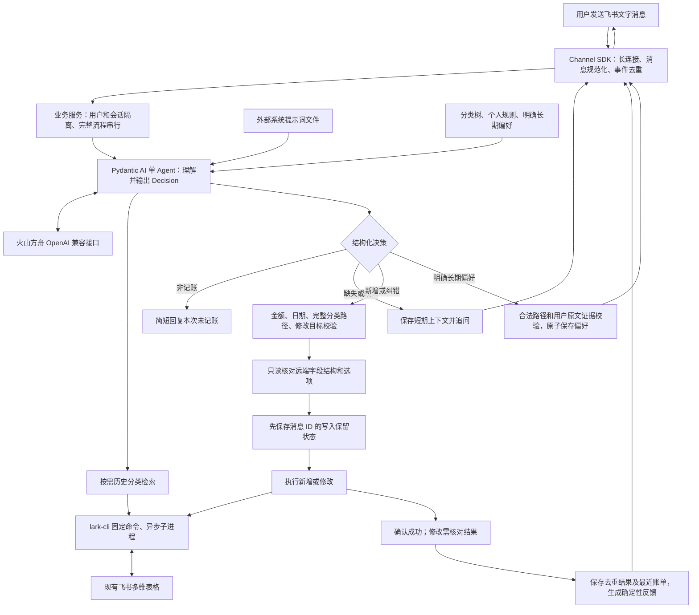

# 飞书记账智能体：系统架构与工作流程

本项目采用 Python 单进程、官方 `lark-channel-sdk`、Pydantic AI 单 Agent、火山方舟和官方 `lark-cli`。LLM 负责理解和分类决策，程序负责结构与业务校验、会话顺序及数据写入。

原有只读查询链路已用于验证通信和 CLI 接入，本次实现围绕实际消费记账扩展。系统提示词从指定文件读取，正式提示词待提供。已完成离线组件与协议测试，并核对真实表格结构；正式模型及飞书记账往返尚待验收。

## 模块边界

| 模块 | 职责 |
| --- | --- |
| Channel | 接收文字消息，提取 ID、发送者、会话和发送时间，发送业务结果 |
| Agent | 从外部文件加载系统提示词，结合个人知识输出 Pydantic 决策，必要时查询历史案例 |
| 知识 | 独立管理分类树、原始规则、表结构与明确长期偏好 |
| 业务执行 | 校验、追问、纠错目标约束、去重、执行控制与结果反馈 |
| CLI 边界 | 固定读写命令、参数列表、超时、取消清理与结果解析 |

不拆分独立服务，不引入多 Agent、LangGraph、数据库、向量库、Redis 或消息队列。

## 理解与分类

同一个 Agent 先在无业务工具的情况下判断意图并输出 `Decision`。非记账输出 `ignore`，服务简短回复「这条消息未涉及实际消费，本次未记账。」，不调用业务工具。已确认消费需要历史分类依据时，下一轮才开放 `search_history`。历史只返回有效分类路径的消费描述与类别；不用历史频率投票，不能覆盖明确规则。

静态分类规则、完整分类树和最新长期偏好每轮作为基础上下文提供。分类知识独立于 Agent Runtime，修改原始知识不需要修改 Agent 代码。系统提示词文件在启动时读取，缺失或为空时不启用模型运行。

## 新增消费

1. 以原消息发送时间及配置时区理解绝对、相对日期。
2. 未指定日期时使用该消息在配置时区的日期。
3. 金额、描述、分类缺失或有歧义时追问；多笔独立消费要求分别发送。
4. 校验有限正数金额和两位小数精度，校验完整合法分类路径。
5. 读取远端字段结构；对截断的单选选项补查完整数据。
6. 原子保存写入保留状态，调用 CLI 创建一条记录。
7. 仅在成功响应携带唯一记录 ID、没有忽略字段时，记录成功并回复结果。

只写日期、金额、具体内容和分类。公式字段、附件及支出频率不主动写入。CLI 接收使用 `Decimal` 输出的 JSON 数字，不通过 Python `float` 转换。

## 追问与即时纠错

短期状态按 `(user_id, chat_id)` 隔离，保留待追问事实、最近成功账单 ID 与字段、必要的最近对话。每个会话内的完整处理流程串行，同一目标表的写操作也串行。

追问跨午夜仍使用原消费时间基准，并合并每轮已明确字段；新消费不会继承旧追问日期。状态超过配置有效期或应用重启后，不再提供即时纠错目标。

纠错只能修改当前用户、当前会话最近成功账单。先读取该记录，若不存在或被外部修改则停止；提交变化字段后，再读取核对结果。若修改尚未可见或无法读取，回复结果待核对，不宣称已完成修改。改为无三级分支的类别时，清空此前的三级分类。

## 长期偏好

单次纠错不修改分类规则。用户明确表达长期偏好时，Agent 输出 `preference`，包含适用对象、条件、合法分类路径和用户原文证据。程序确认长期表达及原文归属后，原子保存到 `knowledge/preferences.json`。

新的明确偏好优先于旧规则，同一对象的明确更新替换其旧偏好。原始 `rules.json` 保留不变，已有账单不自动重分类。

## 去重与不确定结果

SDK 的去重只处理事件层面，业务层另保存 `.runtime/operations.json`：

| 状态 | 处理 |
| --- | --- |
| 没有记录 | 可以进入理解、校验和执行流程 |
| `started` 或 `uncertain` | 结果未确认，重复投递只提示核对，不重复写入 |
| `success` | 重复投递静默结束 |

写入前持久化 `started`；远端确认成功后持久化 `success`。CLI 超时、取消、异常响应或进程退出留下的 `started` 都按不确定处理。即使已写入但发送回复失败，也不重新创建账单。

业务去重文件只保存消息 ID、状态和必要账单 ID，保留在重启后；业务会话和最近账单上下文在内存中维护。完整调试记录统一保存在 `MESSAGE_LOG_DIR/messages/` 下，每次消息投递创建一个文件，文件名为 `yyyyMMdd_HH:mm_ss.log`，时间使用 `DISPLAY_TIMEZONE`。文件名冲突时按秒递增，日志内容保留实际记录时间；重投递和重启后创建新文件。记录覆盖原始消息、会话上下文、Agent 节点、工具与输出校验、runtime 请求、实际 HTTP 请求与响应、解析后的模型结果、重试、业务操作和回复。总运行日志默认保存在 `logs/service.log`，记录连接状态及消息文件路径。

日志观察通过生命周期钩子实现，保留 `agent.run()` 和非流式模型请求。凭证字段和已知密钥替换为 `[REDACTED]`，业务正文、模型返回与 CLI 输出完整保留。CLI 临时文件在成功、失败、超时和取消后删除，删除前保存返回文件内容。用户错误反馈保持简洁，消息日志记录堆栈和原因链。

消息日志不可用时，停止后续模型调用与新写入；已提交的表格操作继续必要的只读核对和去重状态保存，不重新提交。反馈根据实际结果说明未写入、已成功或待核对，并说明日志失败。回复已发送后不再次发送。日志目录不可用时停止启动，详细配置与排查步骤见 README。

配置见 [README](../README.md)，真实验收见 [端到端测试方法](e2e-test.md)。
