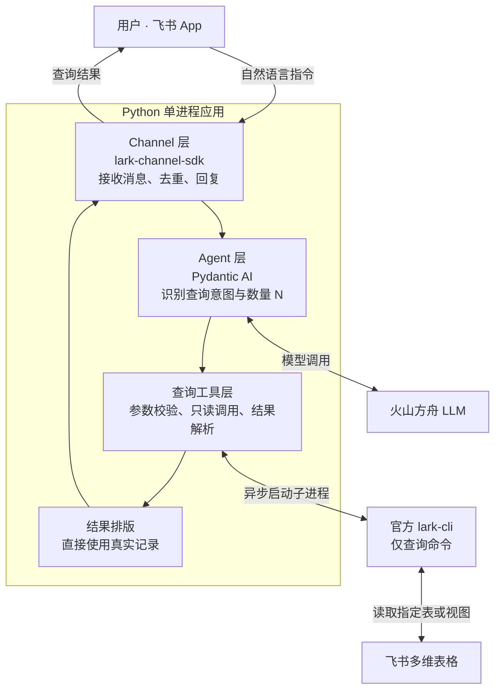

# 飞书记账 Agent：系统架构与工作流程

本文描述当前已实现的最小只读查询框架。用户在飞书 App 中发送自然语言指令，Agent 识别查询数量，从指定多维表格或视图读取最近 N 条消费记录，并回复原消息。

目前已通过用户在飞书 App 内的实际测试，可以返回指定条数的消费记录。

## 系统架构

Python 应用以单进程运行，CLI 作为短生命周期的外部子进程执行查询。SDK 负责长连接和消息处理，不需要额外的 Web 服务、数据库或消息队列。

| 模块 | 组件 | 职责 |
| --- | --- | --- |
| Channel 层 | `lark-channel-sdk` | 维护飞书 WebSocket 长连接，规范化接收消息，复用去重和同会话串行处理，回复原消息 |
| Agent 层 | Pydantic AI + 火山方舟 | 理解自然语言查询意图，提取数量 N，调用唯一的查询工具 |
| 查询工具层 | Python + 官方 `lark-cli` | 校验参数，执行固定的只读查询命令，处理超时、错误和返回数据 |
| 结果排版 | Python | 校验并展示日期、金额、描述及实际返回条数，不使用模型生成的消费明细 |
| 配置管理 | Pydantic Settings | 从 `.env` 或环境变量读取应用凭证、模型、表格、视图和字段配置 |

## 工作流程

以「查询最近 10 条消费记录」为例：

1. **接收消息**：飞书通过已订阅的 `im.message.receive_v1` 事件和 WebSocket 长连接，将消息交给 Channel。
2. **理解指令**：Pydantic AI 调用火山方舟模型，识别只读查询意图，提取 `N=10`。
3. **调用工具**：Agent 调用 `recent_expenses(n=10)`，工具校验 N 是否为 1–100 的整数。
4. **读取记录**：工具异步调用 `lark-cli base +record-list`，在配置的表或视图范围内，先按记账日期在服务端降序排序，再取前 10 条。
5. **解析和排版**：Python 解析查询结果，校验日期、金额和描述，生成回复。模型只收到查询完成摘要，消费明细由程序直接展示。
6. **回复消息**：Channel 回复原消息。记录不足时注明实际返回条数；查询失败或超时时返回对应提示。

完成查询后清理临时导出文件；超时或取消时结束 CLI 子进程。发送失败会记录错误，不计为回复成功。

## 查询范围与边界

- `BITABLE_BASE_TOKEN` 指定多维表格，`BITABLE_TABLE_ID` 指定数据表。
- `BITABLE_VIEW_ID` 可选：填写时保留指定视图的筛选范围，留空时查询整张表。
- 两种模式均按记账日期降序查询，只覆盖本次读取的排序，不修改视图配置。
- 整表模式自动筛选记账日期非空的记录。视图模式不传额外筛选条件，避免覆盖视图筛选；若返回空日期，则提示在视图中设置日期非空条件后重试。
- 未指定数量时默认查询 10 条，支持 1–100 条；日期相同时不承诺固定次序。
- 模型只能提供 N，不能指定 CLI 命令、目标表格、字段或筛选条件。
- 当前严格只读，没有新增、修改、删除记录的接口；暂不实现消费分类、记账写入、历史知识检索、临时条件筛选或统计。

## 实现入口

| 文件 | 内容 |
| --- | --- |
| `src/bookkeeping_agent/channel.py` | Channel 创建、消息接收和回复 |
| `src/bookkeeping_agent/agent.py` | Agent、工具注册及结果排版 |
| `src/bookkeeping_agent/tools.py` | CLI 只读查询封装 |
| `src/bookkeeping_agent/config.py` | 配置加载与校验 |
| `src/bookkeeping_agent/__main__.py` | 组件装配、启动和诊断入口 |

配置和启动方法见 [README](../README.md)，完整验证步骤见 [端到端测试方法](../docs/e2e-test.md)。
